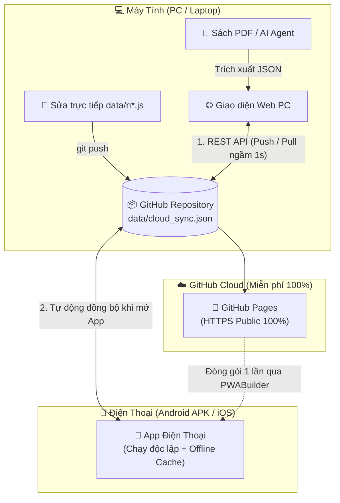

# 📚 JLPT Smart Hub Pro — Hệ Sinh Thái Tự Học Tiếng Nhật (Web & Mobile App)

Hệ thống học **Từ Vựng, Ngữ Pháp & Đọc Hiểu JLPT (N5 – N1)** được thiết kế theo kiến trúc **Local-First + GitHub Cloud Sync 2 chiều**, giúp đồng bộ tức thì dữ liệu học tập và tiến độ cá nhân giữa **Máy tính (Web)** và **Điện thoại (Android APK / iOS PWA)** mà không tốn bất kỳ chi phí máy chủ nào.

---

## 📂 1. Cấu Trúc Thư Mục Chuyên Nghiệp (Project Structure)

Toàn bộ các file tạm, dữ liệu trùng lặp và mã nguồn rối rắm đã được dọn dẹp và tách lớp theo chuẩn Modular:

```text
JLPT-Hub/
├── index.html                  # Giao diện chính (Semantic HTML5 gọn nhẹ)
├── manifest.json               # Cấu hình Web App Manifest đạt chuẩn 100% PWABuilder / APK
├── sw.js                       # Service Worker (Quản lý Offline Cache & Network-First Data)
├── .gitignore                  # Bỏ qua thư mục PDF nặng (71MB) khi đẩy lên GitHub
├── README.md                   # Tài liệu Kiến trúc Pipeline & Hướng dẫn vận hành
│
├── assets/                     # Tài nguyên giao diện & Logic ứng dụng
│   ├── css/
│   │   └── style.css           # Stylesheet Desktop + Mobile Responsive + Safe-Area
│   ├── js/
│   │   ├── github-sync.js      # Engine đồng bộ 2 chiều thời gian thực qua GitHub REST API
│   │   └── app.js              # Logic cốt lõi: Filter, Search, Flashcard Swipe, Quiz Pro
│   └── icons/                  # Bộ Icon chuẩn Android APK / iOS / Favicon
│       ├── icon-192.png
│       ├── icon-512.png
│       ├── apple-touch-icon.png
│       └── favicon.svg
│
├── data/                       # Kho dữ liệu học tập & File trạng thái Cloud Sync
│   ├── n5.js ... n1.js         # Kho dữ liệu tĩnh theo từng cấp độ (N2 có sẵn 664 từ + 94 ngữ pháp)
│   └── cloud_sync.json         # File trung tâm đồng bộ tự động (Extra Data + ⭐ Cần ôn + ✅ Đã thuộc)
│
├── tools/                      # Bộ công cụ tạo dữ liệu trên máy tính
│   ├── pdf-converter.html      # Công cụ trích xuất sách PDF sang JSON tự động
│   └── agent-prompt.md         # Prompt mẫu dùng cho AI Agent phân tích ngữ liệu
│
└── data_pdf/                   # (Chỉ lưu ở máy tính, đã đưa vào .gitignore) Chứa sách PDF gốc
```

---

## 🔄 2. Pipeline Hệ Thống (System Architecture & Data Pipeline)



### Chi tiết 3 luồng vận hành:
1. **Luồng Khởi động Tức thì (0ms Instant Boot)**:
   * Khi bạn mở App trên điện thoại hoặc Web trên máy tính, ứng dụng hiển thị ngay lập tức từ bộ nhớ máy (`localStorage` + `Service Worker Cache`).
   * Ngay sau đó 0.4 giây, `GitHubSync.pull()` âm thầm kiểm tra file `data/cloud_sync.json` trên GitHub để tải về từ vựng mới và tiến độ học tập mới nhất.
2. **Luồng Đồng bộ 2 chiều Tự động (Auto Push/Pull)**:
   * **Thêm từ mới ở máy tính**: Bạn bấm `➕ Dán Data` trên Web ➔ Dữ liệu nạp vào máy và tự động đẩy thẳng lên `data/cloud_sync.json` trên GitHub ➔ Điện thoại mở App lên tự động nhận được toàn bộ từ mới mà **không bao giờ phải cài lại file APK**.
   * **Học trên điện thoại**: Bạn bấm `⭐ Cần ôn` hoặc `✅ Đã thuộc` trên điện thoại ➔ Sau 1.2 giây (debounce chống nghẽn), App tự đẩy trạng thái mới lên GitHub ➔ Mở máy tính lên thấy khớp 100%.
3. **Luồng Chống Mất Mạng (Offline Resilience)**:
   * Nếu bạn đang đi tàu xe không có mạng, mọi đánh dấu của bạn được ghi nhận trạng thái `⏳ Chờ đồng bộ`. Ngay khi điện thoại bắt được Wi-Fi/4G trở lại, sự kiện `window.ononline` tự động kích hoạt đẩy dữ liệu lên GitHub.

---

## 🚀 3. Hướng Dẫn Đưa Lên GitHub & Xuất File APK (Không Bị Lỗi 401)

### Bước 1: Đẩy thư mục lên GitHub và bật GitHub Pages (1 phút)
Mở Terminal (PowerShell) tại thư mục `D:\JLPT-Hub` và chạy:
```powershell
git init
git add .
git commit -m "Initialize JLPT Smart Hub Pro"
git branch -M main
git remote add origin https://github.com/<USERNAME_CUA_BAN>/JLPT-Hub.git
git push -u origin main
```
* Vào trang Repository trên GitHub ➔ **Settings** ➔ **Pages** (menu bên trái).
* Mục **Branch**, chọn nhánh `main` ➔ Bấm **Save**.
* Sau 30 giây, bạn có đường link chính chủ công khai 100%: `https://<USERNAME_CUA_BAN>.github.io/JLPT-Hub/`.

### Bước 2: Đóng gói thành file `.apk` chuẩn trên PWABuilder (1 phút)
1. Mở [https://www.pwabuilder.com](https://www.pwabuilder.com) và dán link GitHub Pages ở Bước 1 vào.
2. Vì GitHub Pages mở công khai (không chặn 401 như Netlify), PWABuilder sẽ đọc được ngay `manifest.json` và `sw.js`, chấm điểm **Xanh 100%**.
3. Bấm **Package For Stores** ➔ Chọn **Android** ➔ **Download Package** để lấy file `.apk` cài vào điện thoại.

### Bước 3: Bật Đồng bộ 2 chiều (Nhập 1 lần duy nhất)
1. Truy cập trang tạo Token nhanh của GitHub: [Tạo Personal Access Token (Classic)](https://github.com/settings/tokens/new?scopes=repo&description=JLPT-Hub-Sync).
2. Tích chọn ô **`repo`** ➔ Cuộn xuống bấm **Generate token** ➔ Copy mã `ghp_...`.
3. Mở Web trên máy tính và App trên điện thoại ➔ Bấm vào nút **`☁️ Cloud Sync`** trên thanh tiêu đề ➔ Dán mã Token vào và bấm **Lưu & Đồng bộ ngay**.
4. Từ giây phút này, máy tính và điện thoại của bạn đã hòa làm một hệ thống hoàn chỉnh!
